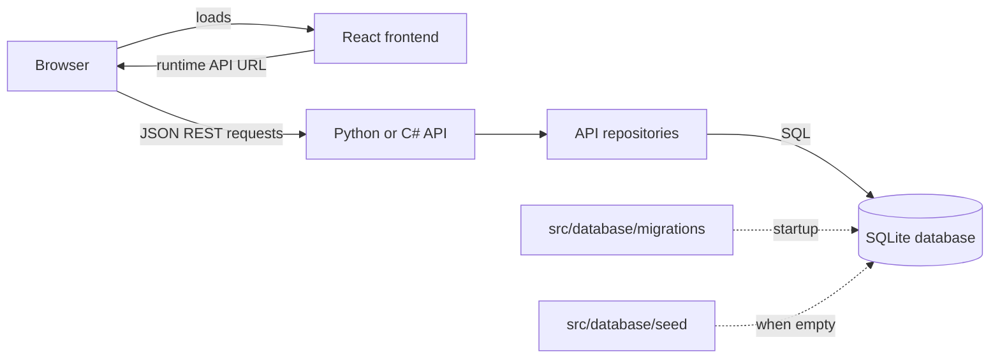

# OctoSupply architecture

OctoSupply is a demonstration supply-chain application. This checkout contains
a React frontend, Python and C# REST APIs, and shared SQLite migration and seed
files. The Python API is the deployment and checkout-feature track. The APIs
share the database schema, but their feature coverage is not guaranteed to be
identical.

## Request and data flow

The browser loads the static frontend and then calls the API directly; the
frontend does not proxy API traffic. In local development the API URL is set
with `VITE_API_URL`. In the frontend container it is generated at startup from
`API_HOST`, `API_PORT`, and `API_PROTOCOL`.

The APIs use repository/data layers for database access. The Python API uses
FastAPI routers and asynchronous repositories; the C# API uses ASP.NET Core
controllers and repositories. Both apply the shared SQL migrations and seed
files when starting from their respective API directories.

## Components

| Component | Implementation | Local port / docs |
| --- | --- | --- |
| Frontend | React, TypeScript, Vite, Tailwind CSS | Vite: 5137 |
| Python API | FastAPI, Pydantic, aiosqlite | API: 3000; Swagger UI: `/docs` |
| C# API | ASP.NET Core, Microsoft.Data.Sqlite | API: 3000; OpenAPI JSON: `/api-docs.json` |
| Database | SQLite with shared SQL migrations and seed files | `DB_FILE`, relative to API working directory |

The Azure deployment builds and runs the Python API and the static frontend in
separate Azure Container Apps. See the [deployment guide](../../infra/README.md)
for its network, identity, and persistence limitations.

## Data model

The core schema covers suppliers, headquarters, branches, products, orders,
order details, deliveries, and order-detail/delivery relationships. Later
migrations add supplier status fields, checkout receipts, discount codes, and
order discount snapshots. The schema and migration order are documented in
[SQLite integration](sqlite-integration.md).

## Operations and limitations

- The API root route (`/`) is used for the container readiness and liveness
  probes; it is a basic HTTP check, not a deep dependency check.
- Azure Container Apps logs are sent to the deployment's Log Analytics
  workspace. The application does not currently configure TAO, OpenTelemetry,
  a telemetry `/metrics` endpoint, or distributed tracing. The API's business
  metrics routes are not application telemetry.
- The API has no authentication. CORS is not an access-control boundary.
- Azure demo SQLite storage is on the container filesystem and is not durable
  across container replacement. Checkout is simulated and does not process
  real payments.

See [observability](observability.md) and
[system overview and deployment](system-overview-and-deployment.md) for the
current operational setup.
