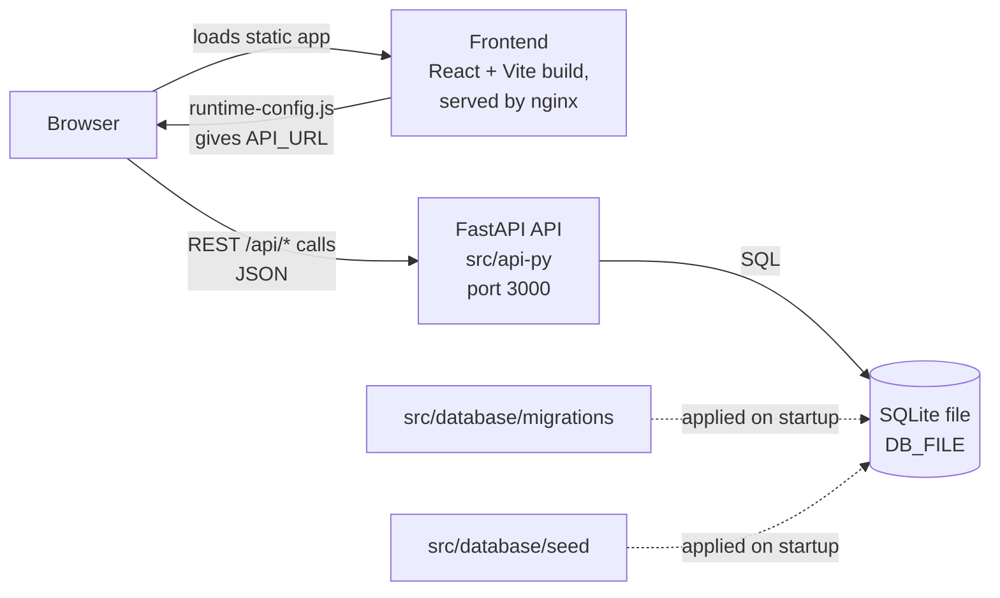

# System Overview and Deployment

This guide explains how the frontend, API, and database fit together, and how to deploy the API and frontend. For the detailed component and data model, see [architecture.md](./architecture.md) and [sqlite-integration.md](./sqlite-integration.md).

## How the pieces fit together



- **Frontend** (`src/frontend`): a single-page React app. It is built once into static files. At runtime the browser calls the API directly; the frontend does not proxy API traffic.
- **API** (`src/api-py`): a FastAPI app that serves the OctoCAT Supply API routes (for example `/api/products`, `/api/orders`) on port 3000.
- **Database** (`src/database`): a SQLite file. The API applies the SQL files in `migrations/` in order, then the files in `seed/` to populate demo data.

### Request flow

1. The browser loads the frontend from its host.
2. The frontend reads `window.RUNTIME_CONFIG.API_URL` (set at container start, see below) or, in local dev, `VITE_API_URL`.
3. Each entity call goes to `API_URL` + `/api/<entity>`.
4. The API reads or writes SQLite through its repository layer and returns JSON.

### Ports

| Component | Local port | Container port | Notes |
| --- | --- | --- | --- |
| Frontend dev server (Vite) | 5137 | n/a | `make dev-py` from `src/` |
| API (`api-py`) | 3000 | n/a | Swagger UI at `/docs` |
| Frontend (nginx) | n/a | 80 | Serves the built app |

## Running locally

From `src/api-py`, with Python 3.10 or later:

```bash
uv venv --python 3.12 .venv
uv pip install -r requirements.txt
.venv/bin/python -m uvicorn main:app --port 3000 --host 127.0.0.1
```

Run it from `src/api-py`. Migrations and seeds are resolved relative to the current directory.

## Deploying the API

The API has no build dependency on the frontend and can be deployed on its own.

The Python API image uses the repository root as its build context so it can copy
the shared database migrations and seed files:

```bash
docker build -f src/api-py/Dockerfile -t octocat-api:local .
```

The image starts Uvicorn on port 3000, runs as a non-root user, and applies
migrations and seeds on startup. Its default SQLite file is `/app/data/app.db`.
On a local host, the API can still be started with Uvicorn from `src/api-py`.

### Configuration

| Variable | Default | Purpose |
| --- | --- | --- |
| `DB_FILE` | `./data/app.db` | Path to the SQLite file. The directory is created if missing. |
| `DB_MIGRATIONS_DIR` | none | Optional override for the migrations folder. |
| `API_CORS_ORIGINS` | none | Comma-separated allowed origins. When unset, only `localhost:5137` and `*.app.github.dev` or `*.azurecontainerapps.io` are allowed. |

Set `API_CORS_ORIGINS` to the frontend's origin in any environment where the browser loads the frontend from a different origin than the API. For example, the local frontend container on port 8080 needs `http://localhost:8080`.

## Deploying the frontend

The frontend is a static build served by nginx. Its API address is set at container start, not at build time, so the same image works in any environment.

### Option A: Container image (`src/frontend`)

```bash
docker build -t octocat-frontend:latest src/frontend
docker run --rm -p 8080:80 \
  -e API_HOST=localhost \
  -e API_PORT=3000 \
  -e API_PROTOCOL=http \
  octocat-frontend:latest
```

Then open http://localhost:8080.

The API must allow this origin. Start it with `API_CORS_ORIGINS=http://localhost:8080`, or the browser will block the API calls.

### How the runtime API address works

`entrypoint.sh` runs when the container starts:

1. Reads `API_HOST`, `API_PORT`, and `API_PROTOCOL`. Defaults are `api`, `3000`, and `https`.
2. Also accepts Azure App Service style overrides `APPSETTING_API_HOST`, `APPSETTING_API_PORT`, and `APPSETTING_API_PROTOCOL`, which take precedence.
3. Writes `/usr/share/nginx/html/runtime-config.js` with `API_URL` set to `protocol://host:port`. The port is omitted when it is 80 or 443.
4. Starts nginx.

The browser then calls that `API_URL` directly. Because the API is called from the browser, the API's host must be reachable from the user's browser, and its CORS settings must allow the frontend origin.

### Option B: Azure Container Apps

The Bicep deployment gives both apps external HTTPS ingress. The frontend image
gets its runtime API address from the API app's public FQDN:

- `API_HOST` to the API's public FQDN.
- `API_PORT` to `443`.
- `API_PROTOCOL` to `https`.

The API's `API_CORS_ORIGINS` is restricted to the frontend origin. The API has
no authentication, so external ingress is suitable only for this public demo.
The Azure deployment keeps one API replica, but the SQLite file is ephemeral:
container replacement, revision changes, or restarts can reset orders and
checkout receipts.

The [infra README](../../infra/README.md) describes the Bicep templates and the deployment commands.

## Deployment checklist

1. Choose and document the database persistence strategy; the Challenge 5 demo
   currently uses a one-replica container with ephemeral SQLite.
2. Start the API from `src/api-py` and note its URL.
3. Set `API_CORS_ORIGINS` to the frontend origin.
4. Deploy the frontend with `API_HOST`, `API_PORT`, and `API_PROTOCOL` pointing at the API.
5. Open the frontend URL and check the browser console for `Runtime config loaded` and the API URL it logs.
6. Call `GET /api/products` on the API to confirm seed data is present.
